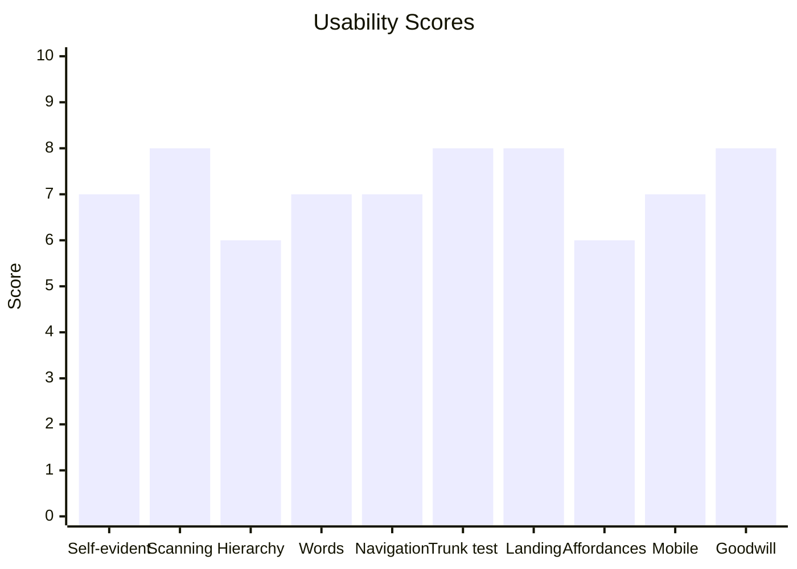
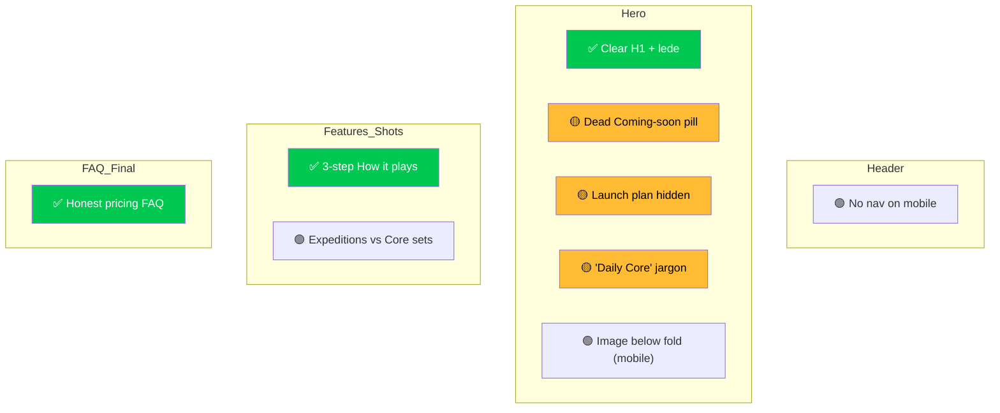
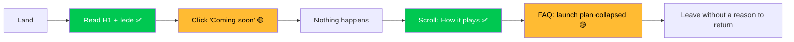

# Usability Review: Thawscope landing page (index.html)

> Orchestrated by: design-optimizer

**Result:** COMPLETE — 6 issues (0 🔴 · 3 🟡 · 3 🟢); 10 of 10 applicable lenses scored

## Thinking Cost: MODERATE

> The heaviest element on the page, the dark "Coming soon to the App Store" pill, looks like a button but does nothing, and nothing nearby says how to come back for the launch.

## Scorecard

| Lens | Score | Why |
|---|---|---|
| Self-evidence | 7/10 | Mechanic explained clearly; "Daily Core" and "Core sets" used before defined |
| Scanning | 8/10 | Clear sections: hero, How it plays, features, shots, FAQ, final |
| Visual hierarchy | 6/10 | Strongest weight goes to a non-interactive `.soon` pill |
| Word economy | 7/10 | Tight copy; hero lede is 4 sentences, long on mobile |
| Navigation | 7/10 | Desktop nav clear; nav hidden at <=820px, no replacement |
| Trunk test | 8/10 | Logo + name + eyebrow "Word puzzle · iPhone · offline" answer what/where |
| Landing clarity | 8/10 | H1 + lede + gameplay screenshot explain the game in 5 s on desktop |
| Affordances | 6/10 | `.soon` styled like a primary button; real links are the white `.btn2` |
| Mobile | 7/10 | Single column works; gameplay image starts below first screen |
| Goodwill | 8/10 | Free/no ads/no account/offline up front; IAP listed honestly in FAQ |

## Issues

### 🟡 Dead "button" is the primary visual call to action
- **Problem:** Dark filled pill with Apple logo reads as a store button; clicking it does nothing.
- **Impact:** Visitors click, get no response, and may think the site is broken.
- **Fix:** Keep the pill, add one plain line under `.cta`: "Not out yet. Bookmark this page; it will link to the App Store on launch day." (reuses existing FAQ wording, no new claim). Changing the pill's look (outline/no fill) = restyle — needs owner.
- **Where:** `index.html` `.hero .cta span.soon` and `section.final .cta span.soon` (local + live)

### 🟡 No way to "remember it for launch" near the top
- **Problem:** The launch plan ("This page will link to it on launch day") sits inside a collapsed FAQ item.
- **Impact:** The page's main goal (come back at launch) is invisible to scanners.
- **Fix:** Surface that existing sentence next to both `.soon` pills (same fix line as above); leave the FAQ answer as is.
- **Where:** `#faq details:last-of-type p` -> move/copy to `.hero .cta` and `.final .cta` (local + live)

### 🟡 Jargon in the hero facts before it is explained
- **Problem:** "A new Daily Core every day" uses an in-game term defined only in section 2.
- **Impact:** First-time readers pause on "Core" in the 5-second scan.
- **Fix:** Change to "A new daily word (Daily Core)"; the features card already says "One word a day" — no new claim.
- **Where:** `index.html` `.hero ul.facts li:nth-child(2)` (local + live)

### 🟢 Mobile header has no navigation
- **Problem:** `header.top nav { display: none; }` at <=820px; FAQ/Support only reachable by scrolling to the footer.
- **Impact:** Mobile users looking for Support or FAQ must scroll the whole page.
- **Fix:** Keep the nav at <=820px with only "FAQ" and "Support" (drop "How it plays", the hero button covers it) at 15px; no colour change.
- **Where:** `index.html` `@media (max-width: 820px) header.top nav` (local; live mobile.png confirms no nav)

### 🟢 "Expeditions" vs "Core sets" naming mismatch
- **Problem:** Home screenshot and its alt text say "Expeditions"; all page copy and caption say "Core sets".
- **Impact:** Readers matching screenshot to copy see two names for one thing.
- **Fix:** Caption: "Home: today's Daily Core and your Core sets (Expeditions)."; or align the term in the app.
- **Where:** `index.html` `.shots figure:first-child figcaption` + `img[src="assets/home.webp"]` alt (local + live desktop-full.png)

### 🟢 Gameplay image below the first mobile screen
- **Problem:** At 390 px the `.phone` image starts about 720 px down (visual estimate from mobile.png), after the lede, CTAs and facts.
- **Impact:** The novel scope mechanic is read as text before it is seen.
- **Fix:** Trim the lede to its first two sentences on mobile, or place `.phone` after the H1 at <=820px (layout order change — confirm with owner; no colour/style change).
- **Where:** `index.html` `.hero` grid at `@media (max-width: 820px)` (live mobile.png)

## Issue Map

## Page Flow Analysis

## What Works

- ✅ H1 "Every word you type shows which way is warmer" + gameplay screenshot explain the core mechanic
- ✅ Numbered 3-step "How it plays" cards and the four thaw-stage chips
- ✅ Free / no ads / no account / offline facts visible in the hero
- ✅ FAQ answers pricing and data honestly; "Get help or send feedback" is a clear secondary action
- ✅ Approved look (frost #F3F5F7, graphite #24282C, orange accent, thermal ramp) — keep unchanged

## Fix Priority

| Priority | Issue | Effort | Impact |
|---|---|---|---|
| 1 | Add launch line under both `.soon` pills (fixes dead button + hidden launch plan) | Low | High |
| 2 | Hero fact "A new daily word (Daily Core)" | Low | Medium |
| 3 | Caption "Core sets (Expeditions)" | Low | Low |
| 4 | Keep FAQ/Support nav on mobile | Low | Low |
| 5 | Mobile hero order / shorter lede | Medium | Low |

## Evidence and Limits

- **Reviewed:** evidence-dir `page.html` (live), `screenshots/desktop.png` 1280x1400, `desktop-full.png` 1280x4200, `mobile.png` 390x2600 (live, headless Chrome); local `/home/lam/Documents/projects/thawscope-site/.claude/worktrees/s9-site/index.html` for selectors
- **Measured:** none — visual inspection only (`process_screenshots.py` not run); pixel positions are estimates
- **Not assessed:** none
- **Not tested:** clicks, hover, focus/skip link, FAQ `details` expand, resize between widths; privacy.html, support.html, 404.html not reviewed for this lens set
- **Assumptions:** Assumption: audience = adults who play daily word puzzles on iPhone; Assumption: primary goal = understand the game and remember it for launch (no store link yet); Assumption: live footer "© 2026 Thawscope" vs local "© 2026 Luong Nguyen" is an intentional local update, not a usability issue

## Next Decision

Redesign Mode was not offered/accepted in this orchestrated run; the owner decides whether to apply fixes 1-4 (copy/markup only) and whether the `.soon` restyle option or the mobile hero reorder is acceptable.
